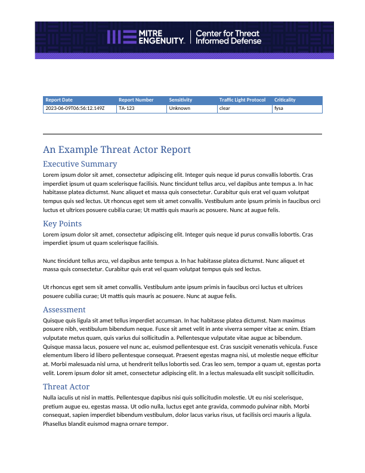

# CTI Publishing Tool

Convierte los JSON exportados por el **CTI Authoring Tool** en informes de inteligencia de amenazas (CTI) en **DOCX, PDF o HTML**. Hay cuatro tipos de informe: Campaign, Executive, Intrusion Analysis y Threat Actor.

Esta carpeta (`src/cti_publishing_tool/` del repositorio CTI Blueprints) contiene el script de publicación. Este fork añade una **versión 2** corregida y ampliada del script, y un **MCP Server** para generar los informes pidiéndolos en lenguaje natural a asistentes como Claude Code o Claude Desktop.

📘 **[Manual de uso completo](docs/MANUAL.md)**: todas las opciones en detalle, diagramas, plantillas corporativas, tablas, referencia del MCP y solución de problemas.



## Contenido

1. [Novedades de la versión 2](#novedades-de-la-versión-2)
2. [Instalación](#instalación)
3. [Uso del script (CLI)](#uso-del-script-cli)
4. [Uso como librería Python](#uso-como-librería-python)
5. [Uso del MCP Server](#uso-del-mcp-server)
6. [Variables de entorno](#variables-de-entorno)
7. [Datos de entrada y datos de prueba](#datos-de-entrada-y-datos-de-prueba)
8. [Pruebas](#pruebas)
9. [Estructura del proyecto](#estructura-del-proyecto)
10. [Solución de problemas](#solución-de-problemas)
11. [Script original (v1)](#script-original-v1)
12. [Créditos](#créditos)

## Novedades de la versión 2

- **PDF en Linux, Windows y macOS** con LibreOffice en modo headless. Si LibreOffice falta, el script muestra los comandos para instalarlo en tu sistema y distribución. En Windows y macOS puede usar Microsoft Word como alternativa.
- **Plantillas DOCX corporativas** (`.docx` / `.dotx`): el informe hereda el encabezado, el pie, los logos, los márgenes, las fuentes y los estilos de la empresa. Si la plantilla tiene el marcador `{{report_content}}`, el informe se inserta ahí y se conservan la portada y el aviso legal.
- **Numeración de páginas automática** en DOCX y PDF, sin configurar nada. Si la plantilla ya numera las páginas, se respeta su numeración.
- **Marca de agua opcional** con la palabra o frase que elijas, por ejemplo `CONFIDENCIAL` o `BORRADOR`.
- **Tablas homogéneas**:
  - ocupan el ancho de la página;
  - el encabezado se repite en cada página;
  - ninguna palabra del encabezado se parte;
  - las proporciones son las mismas en todos los informes.
- **Correcciones del script original**:
  - funciona desde cualquier directorio;
  - admite rutas con espacios;
  - corrige la tabla MITRE del informe Intrusion Analysis;
  - muestra la sección Metadata;
  - valida los argumentos sin mostrar *tracebacks*.
- **MCP Server** con acceso a archivos restringido a directorios permitidos y comunicación por stdio, sin puertos de red.
- **187 pruebas funcionales.**

## Instalación

### Requisitos

| Componente | Versión | Para qué |
| --- | --- | --- |
| Python | 3.10 o superior (probado con 3.14) | Todo |
| LibreOffice | Cualquiera reciente | Solo para generar PDF. En Windows/macOS puede reemplazarse por Microsoft Word |
| Claude Code u otro cliente MCP | — | Solo para usar el MCP Server |

### 1. Clonar el proyecto y crear el entorno virtual

#### Linux / macOS

```bash
git clone https://github.com/AkaPeterArg/cti-blueprints-ia-support.git
cd cti-blueprints-ia-support/src/cti_publishing_tool

python3 -m venv .venv
source .venv/bin/activate
pip install -r requirements.txt
```

#### Windows (PowerShell)

```powershell
git clone https://github.com/AkaPeterArg/cti-blueprints-ia-support.git
cd cti-blueprints-ia-support\src\cti_publishing_tool

py -m venv .venv
.venv\Scripts\Activate.ps1
pip install -r requirements.txt
```

Todos los comandos de este README se ejecutan desde `src/cti_publishing_tool/`. `requirements.txt` instala las dependencias del script original, de la v2 y del MCP Server, con versiones fijas.

### 2. Instalar LibreOffice (solo para PDF)

El proyecto detecta tu sistema y distribución, y te dice qué comando usar:

```bash
python document_converter.py --check
```

| Sistema | Comando |
| --- | --- |
| Ubuntu / Debian / Mint / Kali | `sudo apt install -y libreoffice-writer` (servidores sin entorno gráfico: `libreoffice-writer-nogui`) |
| Fedora / RHEL / Rocky / Alma 8–9 | `sudo dnf install -y libreoffice-writer` |
| RHEL / Rocky / Alma 10+ | `flatpak install -y flathub org.libreoffice.LibreOffice` |
| openSUSE / SLES | `sudo zypper install -y libreoffice-writer` |
| Arch / Manjaro | `sudo pacman -Syu --needed libreoffice-fresh` |
| Alpine | `sudo apk add libreoffice` |
| Windows | `winget install -e --id TheDocumentFoundation.LibreOffice` |
| macOS | `brew install --cask libreoffice` |

Si LibreOffice está instalado en una ruta no estándar, defínela en `LIBREOFFICE_PATH` (ver [Variables de entorno](#variables-de-entorno)).

### 3. Verificar la instalación

```bash
python cti_publishing_tool_v2.py --check_dependencies
```

```text
Python: 3.14.4
Templates: /ruta/al/proyecto/templates/sections
DOCX template ($CTI_DOCX_TEMPLATE): not set
LibreOffice: /usr/bin/soffice (LibreOffice 26.2.6.3 620(Build:3))
```

## Uso del script (CLI)

### Modo guiado

Sin argumentos, el script pregunta paso a paso: tipo de informe, formato, secciones y archivo de datos.

```bash
python cti_publishing_tool_v2.py
```

### Modo con argumentos

```bash
python cti_publishing_tool_v2.py -r <1-4> -f <datos.json> [opciones]
```

| Opción | Descripción |
| --- | --- |
| `-r`, `--report_type` | `1` Campaign · `2` Executive · `3` Intrusion Analysis · `4` Threat Actor |
| `-f`, `--data_input_filepath` | JSON de datos (admite comillas, espacios escapados con barra invertida y `file://`) |
| `-d`, `--document_type` | `docx` (por defecto) · `pdf` · `html` |
| `-e`, `--exclude_section` | Secciones a excluir, separadas por espacios (excluyente con `-o`) |
| `-o`, `--only_section` | Únicas secciones a incluir (excluyente con `-e`) |
| `--output_dir` | Directorio de salida (por defecto `./output`) |
| `--docx_template` | Plantilla corporativa `.docx` / `.dotx` (por defecto `$CTI_DOCX_TEMPLATE`) |
| `--table_style` | Estilo de tabla de Word (por defecto `Light List Accent 1`) |
| `--keep_template_content` | Conserva el cuerpo de la plantilla y añade el informe al final |
| `--watermark` | Marca de agua en diagonal en todas las páginas, con la palabra o frase indicada (hasta 60 caracteres) |
| `--watermark_color` | Color de la marca de agua en hexadecimal `RRGGBB` (por defecto `C0C0C0`, gris claro) |
| `--pdf_engine` | `auto` (por defecto) · `libreoffice` · `word` |
| `--inspect_template` | Analiza una plantilla DOCX, muestra el resultado en JSON y sale |
| `--check_dependencies` | Verifica plantillas y LibreOffice, y sale |
| `--no_interactive` | Nunca pregunta; si falta `-r` o `-f`, termina con error (para scripts y CI) |
| `-v`, `--verbose` | Mensajes de diagnóstico en stderr |
| `--version` / `-h` | Versión / ayuda |

La numeración de páginas no tiene opción porque es automática.

### Ejemplos

```bash
# Campaign Report en DOCX
python cti_publishing_tool_v2.py -r 1 -f "data/An Example Campaign Report.json"

# Threat Actor en PDF, sin IOCs ni firmas
python cti_publishing_tool_v2.py -r 4 -d pdf -f "data/An Example Threat Actor Report.json" -e iocs signatures

# Intrusion Analysis solo con la tabla MITRE y los IOCs, con la plantilla corporativa
python cti_publishing_tool_v2.py -r 3 -d pdf -f "data/An Example Intrusion Analysis Report.json" \
  -o mitre_attack_table iocs --docx_template ../../templates/CTID-IAReportTemplate.docx

# PDF con marca de agua (las páginas se numeran solas)
python cti_publishing_tool_v2.py -r 1 -d pdf -f "data/An Example Campaign Report.json" --watermark "CONFIDENCIAL"

# Analizar una plantilla corporativa antes de usarla
python cti_publishing_tool_v2.py --inspect_template corporativo.dotx

# En scripts o CI: nunca pregunta y devuelve un código de salida
python cti_publishing_tool_v2.py -r 2 -f datos.json --no_interactive || echo "falló con código $?"
```

Las secciones de cada tipo de informe están en el [manual, sección 5](docs/MANUAL.md#5-tipos-de-informe-y-secciones). Para adaptar una plantilla corporativa, consulta la [sección 6](docs/MANUAL.md#6-plantillas-docx-corporativas).

### Códigos de salida

| Código | Significado |
| --- | --- |
| `0` | Documento creado |
| `1` | Error de datos, plantilla, marca de agua o exportación |
| `2` | Argumentos incorrectos o faltantes |
| `3` | Se pidió PDF y no hay LibreOffice ni Word (se muestra cómo instalarlo) |
| `130` | Cancelado por el usuario (Ctrl+C) |

### Conversor DOCX → PDF independiente

`document_converter.py` también se puede usar solo, con cualquier DOCX:

```bash
python document_converter.py informe.docx -o salida/          # convierte a PDF
python document_converter.py --check                          # verifica LibreOffice
python document_converter.py informe.docx --engine word       # usa Microsoft Word (Windows/macOS)
```

## Uso como librería Python

Las funciones de la v2 se pueden usar desde otros programas: no preguntan, no imprimen y devuelven datos serializables a JSON.

```python
import cti_publishing_tool_v2 as cti

result = cti.generate_report(
    "data/An Example Campaign Report.json", "campaign",
    document_type="pdf", watermark="CONFIDENCIAL",
)
print(result["output_path"])   # ruta del PDF
print(result["page_numbers"])  # "added" (numeración añadida) o "template" (la trae la plantilla)

cti.list_report_types()        # tipos de informe y sus secciones
```

Los errores se lanzan como excepciones derivadas de `CTIPublishingError`. La lista completa de funciones está en los docstrings del código.

## Uso del MCP Server

El MCP Server permite que un asistente (Claude Code, Claude Desktop u otro cliente MCP) genere los informes a partir de una petición en lenguaje natural:

> *"Genera el Campaign en PDF con la plantilla CTID y la marca de agua CONFIDENCIAL"*

El asistente decide qué herramientas llamar, y el servidor ejecuta el mismo código que la CLI.

### Herramientas

| Herramienta | Tipo | Uso |
| --- | --- | --- |
| `list_input_files` | lectura | JSON de datos y plantillas DOCX disponibles |
| `list_report_types` | lectura | Tipos de informe y sus secciones |
| `list_sections` | lectura | Secciones de un tipo de informe |
| `preview_report_html` | lectura | Vista previa en HTML, sin crear archivos |
| `generate_report` | **escritura** | Genera el DOCX, PDF o HTML. Admite plantilla y marca de agua; numera las páginas automáticamente |
| `inspect_docx_template` | lectura | Analiza una plantilla corporativa |
| `check_dependencies` | lectura | Verifica LibreOffice, con los comandos de instalación si falta |

### Registro en Claude Code

Ejecuta el registro desde la raíz del proyecto, con el entorno virtual ya creado. Usa siempre **rutas absolutas** (`$PWD` las genera).

El alcance (`--scope`) decide quién puede usar el servidor:

| Alcance (`--scope`) | Dónde se guarda | Quién lo usa |
| --- | --- | --- |
| `local` (recomendado) | `~/.claude.json`, asociado a esta carpeta | Solo tú, solo en este proyecto |
| `user` | `~/.claude.json`, global | Solo tú, en todos tus proyectos |
| `project` | `.mcp.json` en la raíz del repositorio | Todo el equipo (cada persona lo aprueba la primera vez) |

#### Registro en Linux / macOS

```bash
claude mcp add --scope local cti-publishing \
  -e CTI_MCP_DATA_DIRS="$PWD/data" \
  -e CTI_MCP_OUTPUT_DIR="$PWD/output" \
  -- "$PWD/.venv/bin/python" "$PWD/cti_mcp_server.py"
```

#### Registro en Windows (PowerShell)

```powershell
claude mcp add --scope local cti-publishing `
  -e CTI_MCP_DATA_DIRS="$PWD\data" `
  -e CTI_MCP_OUTPUT_DIR="$PWD\output" `
  -- "$PWD\.venv\Scripts\python.exe" "$PWD\cti_mcp_server.py"
```

Las plantillas CTID (`templates/` de la raíz del repositorio) se detectan solas. Para permitir también tus plantillas corporativas, añade `-e CTI_MCP_TEMPLATE_DIRS="$PWD/../../templates:$PWD/corporate-templates"` (en Windows, separadas por `;`).

### Verificación

```bash
claude mcp get cti-publishing     # debe mostrar "Status: ✔ Connected"
claude mcp list                   # todos los servidores registrados
python cti_mcp_server.py --print-config   # configuración efectiva del servidor
```

Dentro de una sesión de Claude Code, `/mcp` muestra el servidor y sus herramientas. Después de registrar el servidor o de actualizar su código, **abre una sesión nueva** o reinícialo desde `/mcp`.

### Ejemplos de uso

| Lo que pides | Lo que hace el asistente |
| --- | --- |
| «¿Qué datos y plantillas hay disponibles?» | `list_input_files` |
| «¿Qué secciones tiene un informe de intrusión?» | `list_sections` |
| «Genera el Campaign en DOCX con la plantilla CTID» | `generate_report` con `docx_template` |
| «Genera el Threat Actor en PDF con la marca de agua CONFIDENCIAL, sin IOCs ni firmas» | `generate_report` con `watermark` y `exclude_sections` |
| «Muéstrame cómo quedaría el Executive sin generar el archivo» | `preview_report_html` |
| «¿Le falta algo a mi plantilla corporativa?» | `inspect_docx_template` |
| «¿Puedo generar PDF en este equipo?» | `check_dependencies` |

**Uso no interactivo** (scripts, CI):

```bash
claude -p "Genera el Campaign en PDF con la marca de agua CONFIDENCIAL. Responde solo con la ruta." \
  --allowedTools "mcp__cti-publishing" --output-format json
```

**Permisos.** La primera vez, Claude Code pide confirmación para cada herramienta. Para permitir siempre las de lectura y seguir confirmando la generación, añade a `.claude/settings.json`:

```json
{
  "permissions": {
    "allow": [
      "mcp__cti-publishing__list_input_files",
      "mcp__cti-publishing__list_report_types",
      "mcp__cti-publishing__list_sections",
      "mcp__cti-publishing__preview_report_html",
      "mcp__cti-publishing__inspect_docx_template",
      "mcp__cti-publishing__check_dependencies"
    ]
  }
}
```

### Otros clientes MCP

Cualquier cliente que admita servidores **stdio** puede usar el formato de [`mcp_config.example.json`](mcp_config.example.json). Reemplaza `/RUTA/AL/REPO` por la ruta absoluta del repositorio clonado.

| Cliente | Archivo de configuración |
| --- | --- |
| Claude Desktop (macOS) | `~/Library/Application Support/Claude/claude_desktop_config.json` |
| Claude Desktop (Windows) | `%APPDATA%\Claude\claude_desktop_config.json` |
| MCP Inspector (pruebas, requiere Node.js) | `npx @modelcontextprotocol/inspector /ruta/.venv/bin/python /ruta/cti_mcp_server.py` |

### Seguridad

- **Lectura:** solo en `CTI_MCP_DATA_DIRS` (`.json`) y `CTI_MCP_TEMPLATE_DIRS` (`.docx` / `.dotx`). Se rechazan `../`, las rutas externas y los enlaces simbólicos que apuntan fuera.
- **Escritura:** solo en `CTI_MCP_OUTPUT_DIR`. El asistente elige el nombre del archivo, que se sanea, pero no la carpeta.
- **Comunicación:** solo por stdio; el servidor no abre puertos de red.
- **Datos en línea:** `report_data` admite como máximo 5 MB.
- **Contenido en la conversación:** solo `preview_report_html` y `report_data` ponen contenido del informe en la conversación con el modelo. El resto de herramientas devuelve rutas y metadatos.

Arquitectura, ciclo de vida, referencia de parámetros y errores: [manual, sección 9](docs/MANUAL.md#9-mcp-server).

## Variables de entorno

| Variable | Usada por | Descripción | Por defecto |
| --- | --- | --- | --- |
| `CTI_DOCX_TEMPLATE` | CLI, MCP | Plantilla corporativa por defecto | (ninguna) |
| `LIBREOFFICE_PATH` | todos | Ruta al ejecutable `soffice` | autodetección |
| `CTI_MCP_DATA_DIRS` | MCP | Carpetas de JSON permitidas (separadas por `:` en Linux/macOS y por `;` en Windows) | `./data` |
| `CTI_MCP_TEMPLATE_DIRS` | MCP | Carpetas de plantillas permitidas | Plantillas CTID (`../../templates`) |
| `CTI_MCP_OUTPUT_DIR` | MCP | Carpeta de salida (la única con escritura) | `./output` |

## Datos de entrada y datos de prueba

- **Datos de ejemplo:** `data/` incluye un JSON de ejemplo por tipo de informe (`An Example … Report.json`), con datos ficticios. Son los únicos datos que se versionan, y los usan las pruebas y los ejemplos.
- **Tus propios datos:** cualquier otro archivo que pongas en `data/` (informes reales, datos de prueba) **lo ignora git**, para que no se suba por error.
- **Plantillas corporativas:** guárdalas en `corporate-templates/`, que git ignora. Las plantillas oficiales CTID están en `templates/` de la raíz del repositorio y los PDF de muestra en `samples/`.
- **Documentos generados:** `output/` también está ignorada.
- **Cómo crear los JSON:** con la aplicación web **CTI Authoring Tool**, cuyo código está en `src/cti_authoring_tool/` del repositorio. El formato está descrito en el [manual, sección 11](docs/MANUAL.md#11-formato-de-los-datos-json).

## Pruebas

```bash
python -m unittest discover -s tests -v
```

| Archivo | Qué cubre |
| --- | --- |
| `tests/test_functional_v2.py` | CLI, secciones, rutas, errores, conversor PDF, comandos de instalación por distribución y paridad con el script original |
| `tests/test_docx_template_v2.py` | Plantillas corporativas: encabezados, pies, logos, márgenes, estilos, listas, marcador `{{report_content}}` y `.dotx` |
| `tests/test_tables_v2.py` | Anchos, encabezado repetido, palabras sin partir, tablas vacías y consistencia entre informes |
| `tests/test_watermark_pages_v2.py` | Marca de agua (DOCX, PDF y HTML) y numeración automática de páginas, desde la CLI y el MCP |
| `tests/test_mcp_server.py` | Herramientas MCP, seguridad de rutas, errores y transporte stdio de extremo a extremo |

Las pruebas de PDF se omiten si LibreOffice no está instalado. Las pruebas escriben solo en directorios temporales, que se borran al terminar; nunca escriben en `output/`.

## Estructura del proyecto

| Ruta | Contenido |
| --- | --- |
| `cti_publishing_tool_v2.py` | CLI v2 y API reutilizable |
| `document_converter.py` | Conversión DOCX → PDF multiplataforma y detección de LibreOffice |
| `cti_mcp_server.py` | MCP Server |
| `cti_publishing_tool.py` | Script original (v1), sin cambios |
| `templates/sections/` | Plantillas Liquid (HTML) de cada sección |
| `../../templates/` | Plantillas DOCX oficiales CTID (raíz del repositorio) |
| `../../samples/` | PDF de muestra de cada informe (raíz del repositorio) |
| `data/` | JSON de ejemplo |
| `tests/` | Pruebas funcionales |
| `docs/` | Manual e imágenes |
| `mcp_config.example.json` | Ejemplo de configuración para clientes MCP |
| `requirements.txt` | Dependencias de Python |

La aplicación web **CTI Authoring Tool**, que genera los JSON, está en `src/cti_authoring_tool/`. En el paquete de distribución (todo en una carpeta, con la aplicación ya compilada), las plantillas CTID están en `cti-templates/` junto al script; el código las encuentra en cualquiera de las dos ubicaciones.

## Solución de problemas

| Síntoma | Solución |
| --- | --- |
| `ALERTA: LibreOffice no está instalado…` (código 3) | Ejecuta el comando que muestra la alerta, o define `LIBREOFFICE_PATH` |
| `Template … does not define: …` (aviso) | La plantilla no tiene esos estilos y se usan los de Word. Defínelos en la plantilla ([manual, 6.3](docs/MANUAL.md#63-adaptar-una-plantilla-una-sola-vez)) |
| Ruta con espacios no encontrada | Ponla entre comillas o escapa los espacios con barra invertida |
| El MCP aparece como *Failed to connect* | Ejecuta a mano el comando registrado con `--print-config` para ver el error. Comprueba que la ruta del intérprete es la del entorno donde instalaste `requirements.txt` |
| El asistente no conoce una opción nueva del MCP | El servidor se carga al iniciar la sesión: abre una nueva o reinícialo desde `/mcp` |
| *outside the allowed directories* | Es el control de seguridad del MCP. Copia el archivo a `data/` o a una carpeta de plantillas permitida, o amplía `CTI_MCP_DATA_DIRS` / `CTI_MCP_TEMPLATE_DIRS` |

Más casos en el [manual, sección 13](docs/MANUAL.md#13-solución-de-problemas).

## Script original (v1)

```bash
python cti_publishing_tool.py -r 1 -f "data/An Example Campaign Report.json"
```

Se mantiene sin cambios, con sus limitaciones originales: genera PDF solo con Microsoft Word y debe ejecutarse desde la raíz del proyecto. Se recomienda usar la v2.

## Créditos

Basado en *cti-publishing-tool*, del **Center for Threat-Informed Defense (MITRE Engenuity)**, parte del proyecto CTI Blueprints.
