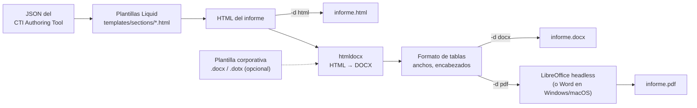
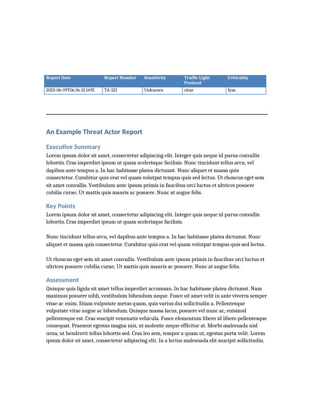
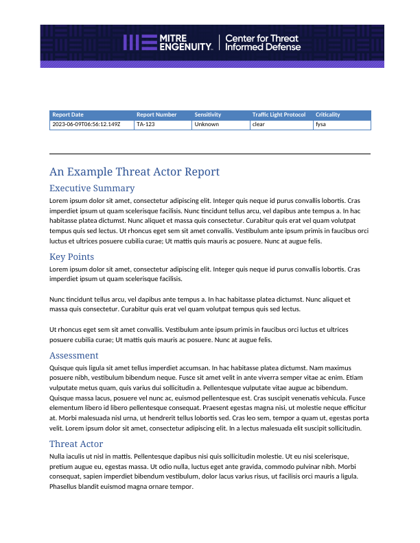
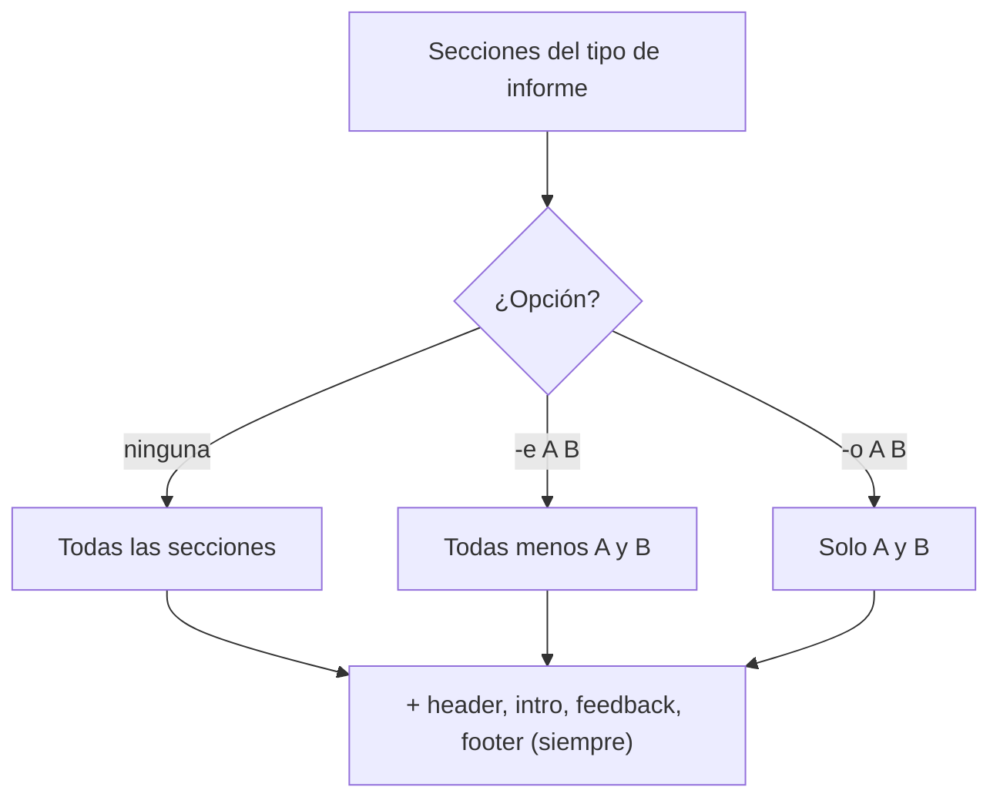
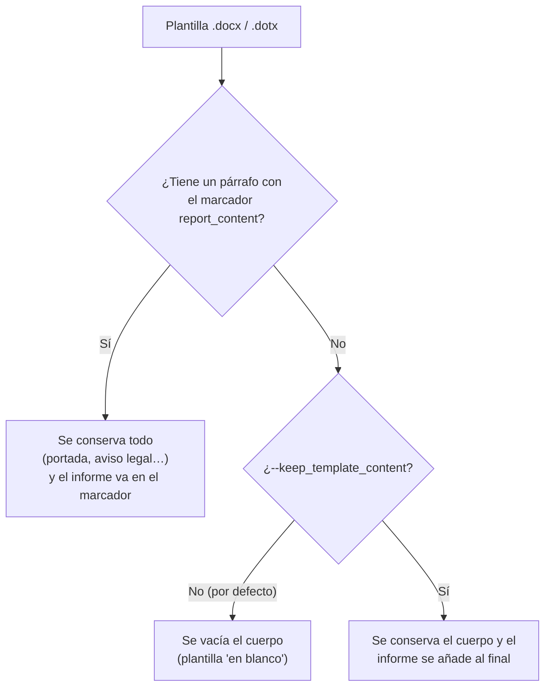
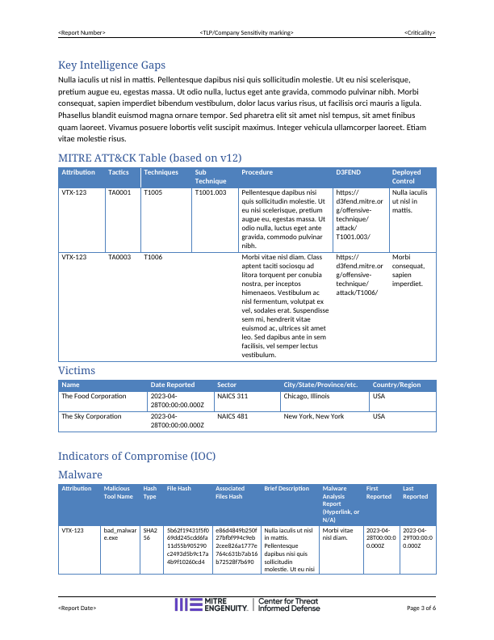
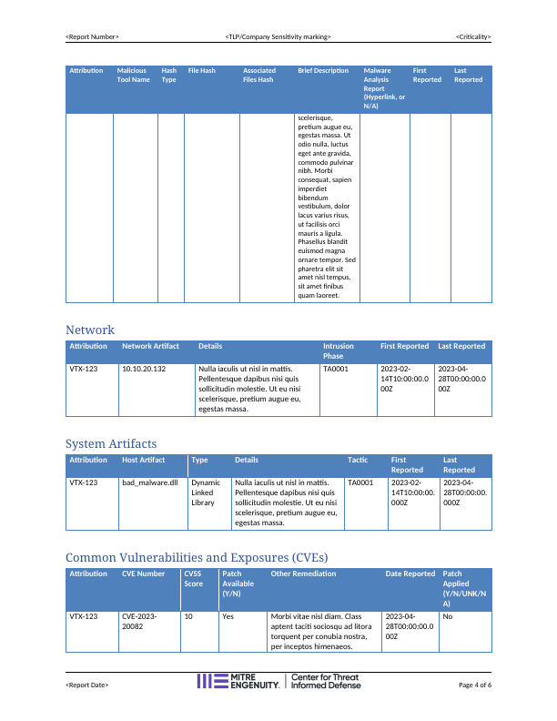
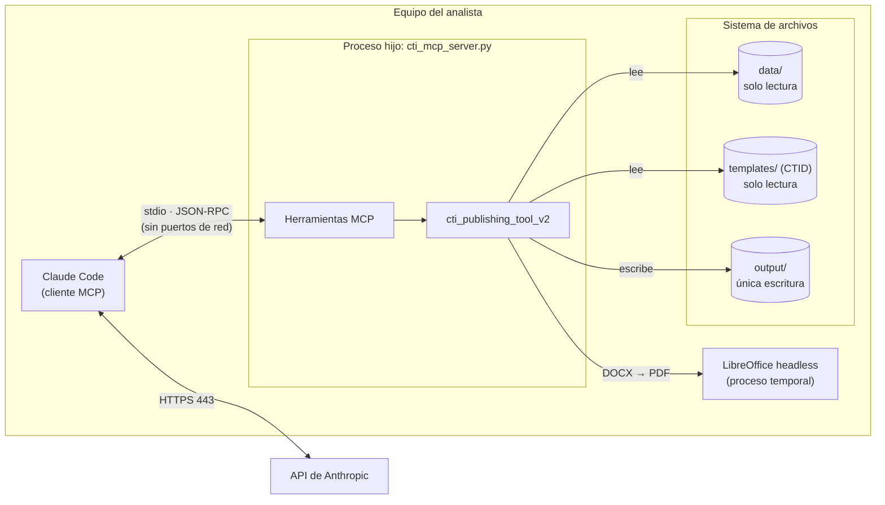
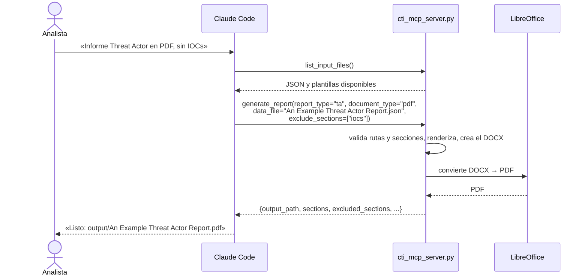

# Manual de uso: CTI Publishing Tool v2 y MCP Server

Convierte los JSON exportados por el **CTI Authoring Tool** en informes de inteligencia de amenazas (CTI) en **DOCX, PDF o HTML**. Se puede usar desde la terminal o desde un asistente como Claude Code, a través del **MCP Server**.

| Componente | Archivo | Para qué |
| --- | --- | --- |
| CLI v2 | `cti_publishing_tool_v2.py` | Generar informes desde la terminal (guiada o con argumentos) |
| Conversor PDF | `document_converter.py` | DOCX → PDF en Linux, Windows y macOS; detectar LibreOffice |
| MCP Server | `cti_mcp_server.py` | Que un LLM genere informes de forma controlada |
| Script original | `cti_publishing_tool.py` | Versión 1, sin cambios (referencia) |

## Contenido

1. [Cómo funciona](#1-cómo-funciona)
2. [Instalación](#2-instalación)
3. [Estructura del proyecto](#3-estructura-del-proyecto)
4. [CLI v2: uso y opciones](#4-cli-v2-uso-y-opciones)
5. [Tipos de informe y secciones](#5-tipos-de-informe-y-secciones)
6. [Plantillas DOCX corporativas](#6-plantillas-docx-corporativas)
7. [Tablas](#7-tablas)
8. [Conversor PDF (`document_converter.py`)](#8-conversor-pdf-document_converterpy)
9. [MCP Server](#9-mcp-server)
10. [Variables de entorno y códigos de salida](#10-variables-de-entorno-y-códigos-de-salida)
11. [Formato de los datos JSON](#11-formato-de-los-datos-json)
12. [Pruebas](#12-pruebas)
13. [Solución de problemas](#13-solución-de-problemas)

---

## 1. Cómo funciona



1. Se cargan los datos JSON y se eligen las secciones del tipo de informe.
2. Cada sección se renderiza con su plantilla Liquid y se obtiene un HTML.
3. El HTML se convierte en DOCX: sobre un documento en blanco o sobre la plantilla corporativa.
4. Se aplica un formato homogéneo a las tablas.
5. Para PDF, el DOCX se convierte con LibreOffice, por lo que el PDF tiene el mismo aspecto que el DOCX.

| Sin plantilla | Con plantilla corporativa (CTID) |
| --- | --- |
|  |  |

---

## 2. Instalación

### 2.1 Requisitos

- **Python 3.10 o superior** (probado con 3.14).
- **LibreOffice**, solo si se generan PDF. En Windows/macOS puede usarse Microsoft Word como alternativa.

### 2.2 Entorno virtual y dependencias

```bash
git clone https://github.com/AkaPeterArg/cti-blueprints-ia-support.git
cd cti-blueprints-ia-support/src/cti_publishing_tool    # todos los comandos del manual se ejecutan aquí

python3 -m venv .venv
source .venv/bin/activate          # Windows (PowerShell): .venv\Scripts\Activate.ps1
pip install -r requirements.txt
```

### 2.3 LibreOffice (para PDF)

El propio proyecto detecta el sistema operativo y la distribución, y muestra los comandos de instalación:

```bash
python document_converter.py --check
```

Si LibreOffice no está instalado, la salida es una alerta como esta (ejemplo en Ubuntu 26.04):

```text
ALERTA: LibreOffice no está instalado o no se encuentra en el PATH. Es necesario para generar documentos PDF.
Sistema detectado: Ubuntu 26.04.1 LTS

Comandos de instalación recomendados:
    sudo apt update
    sudo apt install -y libreoffice-writer

Alternativas:
    sudo apt install -y --no-install-recommends libreoffice-writer-nogui   # mínimo, sin GUI (servidores)
    flatpak install -y flathub org.libreoffice.LibreOffice   # alternativa universal vía Flatpak
    sudo snap install libreoffice   # alternativa vía Snap (confinado: puede no acceder a /tmp)
    Instalador oficial: https://www.libreoffice.org/download/download-libreoffice/
```

Comandos por sistema:

| Sistema | Comando |
| --- | --- |
| Ubuntu / Debian / Mint / Kali | `sudo apt install -y libreoffice-writer` (servidores: `libreoffice-writer-nogui`, Ubuntu ≥ 22.04 / Debian ≥ 11) |
| Fedora | `sudo dnf install -y libreoffice-writer` |
| RHEL / Rocky / Alma 8–9 | `sudo dnf install -y libreoffice-writer` |
| RHEL / Rocky / Alma 10+ | Flatpak: `flatpak install -y flathub org.libreoffice.LibreOffice` |
| CentOS 7 | `sudo yum install -y libreoffice-writer` |
| openSUSE / SLES | `sudo zypper install -y libreoffice-writer` |
| Arch / Manjaro | `sudo pacman -Syu --needed libreoffice-fresh` |
| Alpine | `sudo apk add libreoffice` |
| Windows | `winget install -e --id TheDocumentFoundation.LibreOffice` (o `choco install libreoffice-fresh -y`) |
| macOS | `brew install --cask libreoffice` |

Si LibreOffice está en una ruta no estándar, indícala con `LIBREOFFICE_PATH`:

```bash
export LIBREOFFICE_PATH=/opt/libreoffice/program/soffice                         # Linux/macOS
setx LIBREOFFICE_PATH "C:\Program Files\LibreOffice\program\soffice.exe"         # Windows
```

### 2.4 Verificación

```bash
python cti_publishing_tool_v2.py --check_dependencies
```

```text
Python: 3.14.4
Templates: /ruta/al/repo/src/cti_publishing_tool/templates/sections
DOCX template ($CTI_DOCX_TEMPLATE): not set
LibreOffice: /usr/bin/soffice (LibreOffice 26.2.6.3 620(Build:3))
```

---

## 3. Estructura del proyecto

El script vive en `src/cti_publishing_tool/` del repositorio CTI Blueprints:

```text
cti-blueprints-ia-support/
├── templates/                      # plantillas DOCX oficiales CTID
├── samples/                        # PDF de muestra de cada informe
└── src/
    ├── cti_authoring_tool/         # aplicación web que genera los JSON (Vue)
    └── cti_publishing_tool/        # ← este proyecto
```

```text
src/cti_publishing_tool/
├── cti_publishing_tool_v2.py   # CLI v2 + API (funciones reutilizables)
├── document_converter.py       # DOCX → PDF multiplataforma y detección de LibreOffice
├── cti_mcp_server.py           # MCP Server (stdio)
├── cti_publishing_tool.py      # script original (v1), sin cambios
├── templates/sections/         # plantillas Liquid (HTML) de cada sección
├── data/                       # JSON de ejemplo de los 4 tipos de informe
├── tests/                      # pruebas funcionales (unittest)
├── docs/                       # este manual e imágenes
├── mcp_config.example.json     # ejemplo de configuración MCP
├── requirements.txt
└── output/                     # documentos generados (se crea solo; ignorado por git)
```

Las plantillas CTID se buscan primero en `cti-templates/` junto al script (estructura del paquete de distribución, que trae la aplicación web ya compilada en la misma carpeta) y después en `templates/` de la raíz del repositorio. La constante `CTID_TEMPLATES_DIR` indica cuál se usa.

---

## 4. CLI v2: uso y opciones

### 4.1 Modo guiado

Si falta `-r` o `-f`, la herramienta solo pregunta por lo que falta. Se puede arrastrar el archivo JSON a la terminal: se aceptan comillas, espacios escapados (`\ `) y URIs `file://`.

```text
$ python cti_publishing_tool_v2.py
Not enough arguments provided, please make selections within the CLI.

  Choose what type of report you would like to export:
  1. Campaign Report
  2. Executive Report
  3. Intrusion Analysis Report
  4. Threat Actor Report
>  3
Intrusion Analysis Report template

  Choose what format for the report you would like to generate:
  1. Microsoft Word DOCX file
  2. PDF
  3. HTML
>  2
  Choose an option below:
  1. Select the sections to exclude from the document
  2. Select the sections you would only want in the document
  3. Leave everything in the document.
>  2

Current selection:  (none)
Choose what sections (if any) you would want to include:
  1. Executive Summary
  2. Key Points
  3. Indicator Analysis
  4. MITRE ATT&CK Table
  5. IOCs
  6. Signatures
  7. Intelligence Requirements
  8. Data Sources
  9. Metadata
  Type 'exit' when finished.
>  1 4 5            ← se pueden indicar varias secciones a la vez (espacio o coma)
...
>  exit

Input the full path to the JSON data file for the reports.
>  data/An\ Example\ Intrusion\ Analysis\ Report.json
Document created: /ruta/al/repo/src/cti_publishing_tool/output/An Example Intrusion Analysis Report.pdf
```

Sin terminal interactiva (scripts, CI) o con `--no_interactive`, la herramienta no pregunta: termina con el código 2 e indica qué falta.

### 4.2 Modo con argumentos

```bash
python cti_publishing_tool_v2.py -r <1-4> -f <datos.json> [opciones]
```

| Opción | Valores | Por defecto | Descripción |
| --- | --- | --- | --- |
| `-r`, `--report_type` | `1` `2` `3` `4` | (se pregunta) | Tipo de informe: 1 Campaign, 2 Executive, 3 Intrusion Analysis, 4 Threat Actor |
| `-f`, `--data_input_filepath` | ruta | (se pregunta) | JSON de datos. Admite comillas, `\ ` y `file://` |
| `-d`, `--document_type` | `docx` `pdf` `html` | `docx` | Formato de salida |
| `-e`, `--exclude_section` | secciones… | (ninguna) | Secciones a **excluir**, separadas por espacio. Excluyente con `-o` |
| `-o`, `--only_section` | secciones… | (todas) | **Únicas** secciones a incluir. Excluyente con `-e` |
| `--output_dir` | ruta | `./output` del proyecto | Directorio de salida (se crea si no existe) |
| `--pdf_engine` | `auto` `libreoffice` `word` | `auto` | Motor PDF. `auto`: LibreOffice y, si falta, Word (solo Windows/macOS) |
| `--docx_template` | ruta `.docx`/`.dotx` | `$CTI_DOCX_TEMPLATE` | Plantilla corporativa para DOCX y PDF ([sección 6](#6-plantillas-docx-corporativas)) |
| `--table_style` | nombre | `Light List Accent 1` | Estilo de tabla de Word (p. ej. uno corporativo definido en la plantilla) |
| `--keep_template_content` | (bandera) | no | Conserva el cuerpo de la plantilla y añade el informe al final |
| `--watermark` | texto (≤ 60) | (ninguna) | Marca de agua en diagonal en todas las páginas: cualquier palabra o frase, p. ej. `"CONFIDENCIAL"` ([6.4](#64-marca-de-agua-y-numeración-de-páginas)) |
| `--watermark_color` | `RRGGBB` | `C0C0C0` (gris claro) | Color hexadecimal de la marca de agua, con o sin `#` |
| `--inspect_template` | ruta | | Analiza una plantilla DOCX, muestra un JSON y sale |
| `--no_interactive` | (bandera) | no | Nunca pregunta; si falta `-r` o `-f`, termina con el código 2 |
| `--check_dependencies` | (bandera) | | Verifica plantillas, plantilla por defecto y LibreOffice, y sale |
| `-v`, `--verbose` | (bandera) | no | Muestra mensajes de diagnóstico (stderr) |
| `--version` | | | Muestra la versión |
| `-h`, `--help` | | | Muestra la ayuda |

Notas:

- **Nombres de sección:** se pueden usar los genéricos `mitre_attack_table` y `metadata` también en el informe IA, que internamente usa `mitre_attack_table_ia` y `metadata_ia`.
- **Secciones no aplicables:** las que no corresponden al tipo de informe se ignoran.
- **Nombre del archivo de salida:** es el del JSON. Si ya existe, se sobrescribe.
- **Numeración de páginas:** es automática en DOCX y PDF; no requiere ninguna opción ([6.4](#64-marca-de-agua-y-numeración-de-páginas)).

### 4.3 Ejemplos

```bash
# Campaign Report en DOCX
python cti_publishing_tool_v2.py -r 1 -f "data/An Example Campaign Report.json"

# Threat Actor en PDF, sin IOCs ni Signatures
python cti_publishing_tool_v2.py -r 4 -d pdf -f "data/An Example Threat Actor Report.json" -e iocs signatures

# Intrusion Analysis solo con la tabla MITRE y los IOCs, en HTML
python cti_publishing_tool_v2.py -r 3 -d html -f "data/An Example Intrusion Analysis Report.json" -o mitre_attack_table iocs

# Con plantilla corporativa, en otra carpeta de salida
python cti_publishing_tool_v2.py -r 1 -d pdf -f datos.json --docx_template corporativo.dotx --output_dir ~/informes

# Con marca de agua "CONFIDENCIAL" (las páginas se numeran solas)
python cti_publishing_tool_v2.py -r 4 -d pdf -f datos.json --watermark "CONFIDENCIAL"

# Para scripts / CI (nunca pregunta)
python cti_publishing_tool_v2.py -r 2 -f datos.json --no_interactive || echo "falló con código $?"
```

---

## 5. Tipos de informe y secciones

`header`, `intro`, `feedback` y `footer` se incluyen siempre. Las demás se pueden incluir o excluir con `-e` / `-o`.

| Sección (`-e` / `-o`) | 1 Campaign | 2 Executive | 3 Intrusion Analysis | 4 Threat Actor |
| --- | :-: | :-: | :-: | :-: |
| `executive_summary` | ✔ | ✔ | ✔ | ✔ |
| `key_points` | ✔ | ✔ | ✔ | ✔ |
| `assessment` | ✔ | ✔ | | ✔ |
| `indicator_analysis` | | | ✔ | |
| `outlook` | | ✔ | | |
| `threat_actor` | | | | ✔ |
| `timeline` | ✔ | | | ✔ |
| `intelligence_gaps` | ✔ | ✔ | | ✔ |
| `mitre_attack_table` | ✔ | | ✔ (`_ia`) | ✔ |
| `victims` | | | | ✔ |
| `iocs` | ✔ | | ✔ | ✔ |
| `signatures` | ✔ | | ✔ | ✔ |
| `intelligence_requirements` | ✔ | ✔ | ✔ | ✔ |
| `data_sources` | ✔ | ✔ | ✔ | ✔ |
| `metadata` | ✔ | | ✔ (`_ia`) | ✔ |

El orden de las secciones en el documento es el que define cada tipo de informe (`feedback` va siempre justo antes de `data_sources`). La herramienta MCP `list_sections` lo muestra para cada tipo.



---

## 6. Plantillas DOCX corporativas

Una plantilla `.docx` o `.dotx` con la identidad de la empresa aporta encabezado y pie (con logos y numeración), márgenes, tamaño de página, fuentes, colores del tema y estilos. **El archivo de la plantilla nunca se modifica.**

### 6.1 Modos de inserción



- **Plantilla en blanco** (lo habitual): del cuerpo no se conserva nada. Se conservan los encabezados y pies, incluidos los que una sección hereda de otra anterior.
- **Con marcador:** escribe `{{report_content}}` solo en un párrafo, en el lugar donde debe ir el informe. Por ejemplo: portada, salto de página, `{{report_content}}`, aviso legal.

### 6.2 Plantilla por defecto

```bash
export CTI_DOCX_TEMPLATE=/ruta/corporativo.dotx      # Linux/macOS
setx CTI_DOCX_TEMPLATE "C:\plantillas\corporativo.dotx"   # Windows
```

A partir de ese momento, todos los DOCX y PDF usan esa plantilla sin indicar `--docx_template`. Lo respetan tanto la CLI como el MCP Server.

### 6.3 Adaptar una plantilla (una sola vez)

```bash
python cti_publishing_tool_v2.py --inspect_template ../../templates/CTID-IAReportTemplate.docx
```

```json
{
  "page": { "width_cm": 21.59, "height_cm": 27.94, "margin_left_cm": 2.54, "...": "..." },
  "header_footer_images": 4,
  "normal_font": { "name": null, "size_pt": 10.5 },
  "content_marker": false,
  "mode": "clear_body",
  "table_styles": ["Normal Table", "Table Grid"],
  "missing_styles": ["Heading 3", "List Bullet", "List Number", "Light List Accent 1"],
  "warnings": [
    "The template body has 71 element(s) that will be removed. ...",
    "Missing styles will be copied from Word defaults: Heading 3, List Bullet, ..."
  ]
}
```

Los estilos que el informe usa y la plantilla no define (`missing_styles`) se toman de los de Word por defecto, y la herramienta avisa en cada ejecución. **Para un resultado 100 % corporativo, define en la plantilla** `Heading 1`–`Heading 3`, `List Bullet`, `List Number` y un estilo de tabla. Indica ese estilo con `--table_style` si no se llama `Light List Accent 1`.

> Las tablas usan por defecto `Light List Accent 1`, que toma el **color de acento del tema** de la plantilla: adoptan los colores corporativos sin configurar nada.

### 6.4 Marca de agua y numeración de páginas

Funcionan igual desde la CLI y desde el MCP, con plantilla o sin ella.

**Numeración de páginas: automática.** No hay que indicar nada; todos los DOCX y PDF salen numerados:

| Caso | Resultado | `page_numbers` en la respuesta del MCP |
| --- | --- | --- |
| Sin plantilla | Se añade un pie centrado *Page 1 of 6* | `added` |
| Plantilla que ya numera las páginas (p. ej. las CTID) | Se respeta su numeración, sin duplicarla | `template` |
| Plantilla sin número de página | Se añade el pie numerado, después del contenido que ya tenga el pie | `added` |
| Salida HTML | No aplica (no tiene páginas) | `not_applicable` |

La portada (primera página diferente de la plantilla) no se numera. Se usan campos de Word (`PAGE` y `NUMPAGES`), así que Word y LibreOffice calculan el número y el total reales al abrir el documento o convertirlo a PDF.

**Marca de agua: opcional.** `--watermark "TEXTO"` muestra la palabra o frase que indiques (por ejemplo `CONFIDENCIAL`, `BORRADOR`, `USO INTERNO` o `Propiedad de ACME`) en diagonal, detrás del contenido y al 50 % de opacidad, en todas las páginas, incluida la portada:

- Se crea igual que la marca de agua de Word (*Diseño > Marca de agua*), así que se puede cambiar o quitar desde Word, y LibreOffice la mantiene al convertir a PDF.
- Se añade a los encabezados sin borrar su contenido: los logos y textos de la plantilla se conservan.
- El tamaño se ajusta a la longitud del texto (máximo 60 caracteres, una sola línea).
- Por defecto es gris claro (`C0C0C0`); `--watermark_color` cambia el color en hexadecimal (p. ej. `FF0000` rojo).
- En HTML se añade como texto fijo superpuesto, también al imprimir.

```bash
python cti_publishing_tool_v2.py -r 1 -d pdf -f datos.json --docx_template ../../templates/CTID-CampaignReportTemplate.docx \
  --watermark "CONFIDENCIAL"
```

---

## 7. Tablas

Todas las tablas del informe reciben el mismo formato, en DOCX y PDF, con o sin plantilla:

| Aspecto | Comportamiento |
| --- | --- |
| Ancho | Ocupa el área útil de la página real (Carta, A4, márgenes de la plantilla) |
| Diseño | Fijo: Word y LibreOffice (PDF) muestran la tabla igual |
| Columnas | Ancho según el encabezado: *Procedure*, *Activity* y *Details* anchas; fechas y *CVSS* estrechas. La misma tabla tiene las mismas proporciones en todos los informes |
| Encabezado | En negrita, **se repite en cada página** y queda unido a la primera fila |
| Letra | 9 pt; 8 o 7,5 pt en tablas muy anchas, para que **ninguna palabra del encabezado se parta** |
| Primera columna | Sin negrita forzada |
| Sin datos | Una fila *"No data reported."* que ocupa todas las columnas (HTML, DOCX y PDF) |
| Tablas propias de la plantilla | No se modifican |





Los pesos de las columnas están en `TABLE_COLUMN_WEIGHTS`, dentro de `cti_publishing_tool_v2.py`. Si agregas una tabla nueva a las plantillas, añade sus encabezados ahí; los encabezados que no estén listados reciben peso 1.

---

## 8. Conversor PDF (`document_converter.py`)

Funciona solo o como módulo. Busca LibreOffice en este orden: `LIBREOFFICE_PATH`, el `PATH`, las rutas típicas de cada sistema, el registro de Windows y Flatpak.

```bash
python document_converter.py --check                       # verifica LibreOffice / muestra cómo instalarlo
python document_converter.py informe.docx                  # → informe.pdf junto al DOCX
python document_converter.py informe.docx -o salida/       # → salida/informe.pdf
python document_converter.py informe.docx -o final.pdf --engine libreoffice --timeout 300
```

| Opción | Valores | Por defecto | Descripción |
| --- | --- | --- | --- |
| `docx` (posicional) | ruta | | DOCX a convertir. Sin él, equivale a `--check` |
| `-o`, `--output` | ruta o directorio | junto al DOCX | Destino del PDF |
| `--engine` | `auto` `libreoffice` `word` | `auto` | Motor de conversión |
| `--timeout` | segundos | `180` | Tiempo máximo de la conversión |
| `--check` | (bandera) | | Verifica el motor y muestra los comandos de instalación |

Cada conversión usa un perfil de LibreOffice temporal. Así funciona aunque el usuario tenga LibreOffice abierto y admite conversiones simultáneas.

---

## 9. MCP Server

El MCP Server permite que un asistente (Claude Code, Claude Desktop u otro cliente MCP) genere informes en lenguaje natural:

> «Genera el informe de Threat Actor en PDF con la plantilla corporativa, sin IOCs ni firmas.»

### 9.1 Arquitectura y comunicaciones



- **Sin puertos de red.** El servidor no abre ningún puerto: Claude Code lo lanza como proceso hijo y se comunican por stdin/stdout (transporte **stdio**).
- **Nada sale de la máquina en la generación.** Los datos y los documentos se procesan en local. Al modelo solo le llegan los resultados de las herramientas (rutas, listas de secciones, mensajes), además de lo que el usuario escriba en la conversación. **Excepción:** si se usa `preview_report_html` o se pasan datos con `report_data`, el contenido del informe sí forma parte de la conversación con el modelo.
- **Única conexión externa:** la de Claude Code con la API de Anthropic (HTTPS).

### 9.2 Secuencia de una petición



### 9.3 Configuración del servidor

El servidor se configura **solo con variables de entorno**, que define el cliente al lanzarlo:

| Variable | Qué controla | Por defecto | Ejemplo |
| --- | --- | --- | --- |
| `CTI_MCP_DATA_DIRS` | Carpetas desde las que se pueden leer JSON de datos. Varias separadas por `:` (Linux/macOS) o `;` (Windows) | `<proyecto>/data` | `/srv/cti/data:/srv/cti/entrantes` |
| `CTI_MCP_TEMPLATE_DIRS` | Carpetas desde las que se pueden leer plantillas `.docx`/`.dotx` | Plantillas CTID (`templates/` de la raíz del repositorio) | `/srv/cti/plantillas` |
| `CTI_MCP_OUTPUT_DIR` | **Única** carpeta donde se escriben documentos | `<proyecto>/output` | `/srv/cti/informes` |
| `CTI_DOCX_TEMPLATE` | Plantilla corporativa por defecto (si el asistente no indica otra) | (ninguna) | `/srv/cti/plantillas/corporativo.dotx` |
| `LIBREOFFICE_PATH` | Ruta a `soffice` si no está en el `PATH` | autodetección | `/opt/libreoffice/program/soffice` |

Para comprobar qué configuración verá el servidor:

```bash
CTI_MCP_OUTPUT_DIR=/srv/cti/informes python cti_mcp_server.py --print-config
```

```json
{
  "data_dirs": ["/ruta/al/repo/src/cti_publishing_tool/data"],
  "template_dirs": ["/ruta/al/repo/templates"],
  "output_dir": "/srv/cti/informes",
  "max_inline_bytes": 5242880,
  "max_preview_chars": 200000
}
```

| Opción de `cti_mcp_server.py` | Descripción |
| --- | --- |
| (sin opciones) | Inicia el servidor por stdio. Queda esperando mensajes MCP en stdin: lo lanza el cliente, no se ejecuta a mano |
| `--print-config` | Muestra la configuración efectiva en JSON y sale |
| `--version` | Muestra la versión |
| `-h`, `--help` | Muestra la ayuda |

### 9.4 Registro en Claude Code y alcances (*scope*)

#### Alcances

| Alcance | Dónde se guarda | Quién lo ve | Cuándo usarlo |
| --- | --- | --- | --- |
| `local` (por defecto) | `~/.claude.json`, asociado a la carpeta del proyecto | Solo tú, solo en este proyecto | Uso personal en tu equipo (recomendado) |
| `user` | `~/.claude.json`, global | Solo tú, en **todos** tus proyectos | Quieres generar informes desde cualquier carpeta |
| `project` | `.mcp.json` en la raíz del repositorio | Todos los que clonen el repositorio (con aprobación) | Equipos que comparten la configuración |

Si el mismo nombre está definido en varios alcances, gana `local`, luego `project` y por último `user`.

#### Registro con alcance `local` (recomendado)

Desde `src/cti_publishing_tool/`, con el entorno virtual creado (sección 2). Las plantillas CTID se detectan solas, así que no hace falta `CTI_MCP_TEMPLATE_DIRS` salvo para añadir carpetas de plantillas corporativas:

```bash
# Linux / macOS
claude mcp add --scope local cti-publishing \
  -e CTI_MCP_DATA_DIRS="$PWD/data" \
  -e CTI_MCP_OUTPUT_DIR="$PWD/output" \
  -- "$PWD/.venv/bin/python" "$PWD/cti_mcp_server.py"
```

```powershell
# Windows (PowerShell)
claude mcp add --scope local cti-publishing `
  -e CTI_MCP_DATA_DIRS="$PWD\data" `
  -e CTI_MCP_OUTPUT_DIR="$PWD\output" `
  -- "$PWD\.venv\Scripts\python.exe" "$PWD\cti_mcp_server.py"
```

| Parte del comando | Significado |
| --- | --- |
| `claude mcp add` | Registra un servidor MCP en Claude Code |
| `--scope local` | Alcance (`local`, `user` o `project`; ver tabla anterior). También `-s` |
| `cti-publishing` | Nombre del servidor. Sus herramientas se llamarán `mcp__cti-publishing__<herramienta>` |
| `-e VAR=valor` | Variable de entorno para el servidor; se repite una vez por variable ([9.3](#93-configuración-del-servidor)) |
| `--` | Separa las opciones de `claude` del comando que lanza el servidor |
| `.venv/bin/python` | Intérprete del entorno virtual donde se instaló `requirements.txt`. Usa siempre una **ruta absoluta** |
| `cti_mcp_server.py` | El servidor (ruta absoluta) |

No hace falta indicar `--transport`: el valor por defecto es `stdio`, el que usa este servidor.

Alternativa en una sola línea con JSON (mismo formato que `mcp_config.example.json`):

```bash
claude mcp add-json --scope local cti-publishing \
  '{"type":"stdio","command":"/ruta/al/repo/src/cti_publishing_tool/.venv/bin/python","args":["/ruta/al/repo/src/cti_publishing_tool/cti_mcp_server.py"],"env":{"CTI_MCP_OUTPUT_DIR":"/ruta/al/repo/src/cti_publishing_tool/output"}}'
```

#### Registro con alcance `user`

El mismo comando con `--scope user`. Como las rutas son absolutas, funciona desde cualquier carpeta.

#### Registro con alcance `project` (compartido por el equipo)

Crea `.mcp.json` en la raíz del repositorio. Claude Code expande variables de entorno con `${VAR}`, así que cada persona define `CTI_HOME` con la ruta de su clon (p. ej. `export CTI_HOME=~/cti-blueprints-ia-support`) sin tocar el archivo:

```json
{
  "mcpServers": {
    "cti-publishing": {
      "type": "stdio",
      "command": "${CTI_HOME}/src/cti_publishing_tool/.venv/bin/python",
      "args": ["${CTI_HOME}/src/cti_publishing_tool/cti_mcp_server.py"],
      "env": {
        "CTI_MCP_DATA_DIRS": "${CTI_HOME}/src/cti_publishing_tool/data",
        "CTI_MCP_TEMPLATE_DIRS": "${CTI_HOME}/templates",
        "CTI_MCP_OUTPUT_DIR": "${CTI_HOME}/src/cti_publishing_tool/output"
      }
    }
  }
}
```

- **Aprobación:** cada persona debe aprobar el servidor la primera vez. Hasta entonces, `claude mcp list` lo muestra como `⏸ Pending approval`. Para volver a preguntar: `claude mcp reset-project-choices`.
- **Versionarlo:** la versión con `${CTI_HOME}` no contiene rutas personales, así que se puede subir al repositorio. Si escribes rutas absolutas, no lo subas. Dentro de `src/cti_publishing_tool/` el `.gitignore` ya ignora `.mcp.json`.

#### Verificación y gestión

```bash
claude mcp list                    # todos los servidores y su estado
claude mcp get cti-publishing      # detalle: alcance, comando, variables, estado
claude mcp remove cti-publishing -s local   # eliminarlo (indica el alcance)
```

Salida esperada de `claude mcp get`:

```text
cti-publishing:
  Scope: Local config (private to you in this project)
  Status: ✔ Connected
  Type: stdio
  Command: /ruta/al/repo/src/cti_publishing_tool/.venv/bin/python
  Args: /ruta/al/repo/src/cti_publishing_tool/cti_mcp_server.py
  Environment:
    CTI_MCP_DATA_DIRS=/ruta/al/repo/src/cti_publishing_tool/data
    CTI_MCP_OUTPUT_DIR=/ruta/al/repo/src/cti_publishing_tool/output
```

Dentro de una sesión de Claude Code, el comando `/mcp` muestra los servidores conectados y sus herramientas.

### 9.5 Conexión con el cliente (ciclo de vida)

1. **Al abrir una sesión**, Claude Code lanza `cti_mcp_server.py` como **proceso hijo**, con las variables de entorno registradas.
2. **Handshake MCP por stdio:** el servidor envía sus instrucciones de uso y la lista de 7 herramientas con su esquema (tipos, valores permitidos, descripciones). El modelo usa esa información para decidir qué llamar.
3. **Cada llamada** es un mensaje JSON-RPC por stdin. El servidor responde por stdout con el resultado estructurado o con un error. Las herramientas se ejecutan en un hilo aparte, por lo que una conversión a PDF (1–3 s) no bloquea el servidor.
4. **Al cerrar la sesión**, Claude Code termina el proceso. Si cambias el código o las variables de entorno, el cambio se aplica en la **siguiente sesión**.

| Canal | Contenido |
| --- | --- |
| stdin / stdout | Protocolo MCP (JSON-RPC). El servidor no escribe nada más en stdout |
| stderr | Registro de diagnóstico (avisos de estilos de plantilla, errores inesperados con su *traceback*) |
| Red | Ninguna: el servidor no abre puertos ni hace conexiones |

### 9.6 Permisos de las herramientas en Claude Code

La primera vez que el asistente quiere usar una herramienta, Claude Code pide confirmación. Para no tener que confirmar cada vez, añade reglas en `.claude/settings.json` (proyecto) o `~/.claude/settings.json` (usuario). Recomendación: permitir las de lectura y que **`generate_report` siga pidiendo confirmación**, porque escribe y sobrescribe archivos.

```json
{
  "permissions": {
    "allow": [
      "mcp__cti-publishing__list_input_files",
      "mcp__cti-publishing__list_report_types",
      "mcp__cti-publishing__list_sections",
      "mcp__cti-publishing__preview_report_html",
      "mcp__cti-publishing__inspect_docx_template",
      "mcp__cti-publishing__check_dependencies"
    ]
  }
}
```

Para permitir todas las herramientas del servidor, incluida la generación, usa la regla `"mcp__cti-publishing"`.

### 9.7 Uso no interactivo (scripts y automatización)

`claude -p` ejecuta una petición sin conversación interactiva. Con `--allowedTools` se autorizan solo las herramientas de este servidor:

```bash
claude -p "Genera el informe de Threat Actor en PDF a partir del JSON de ejemplo, \
con la plantilla CTID de Threat Actor y sin IOCs ni Signatures. \
Responde solo con la ruta del archivo generado." \
  --allowedTools "mcp__cti-publishing" \
  --max-turns 10 \
  --output-format json
```

| Opción | Significado |
| --- | --- |
| `-p "…"` | Ejecuta la petición y termina (modo *print*) |
| `--allowedTools "mcp__cti-publishing"` | Autoriza todas las herramientas de este servidor sin preguntar; cualquier otra herramienta queda denegada |
| `--max-turns 10` | Límite de pasos del asistente |
| `--output-format json` | Respuesta en JSON (`result`, `is_error`, `num_turns`…), útil para scripts |
| `--mcp-config archivo.json` | Carga servidores desde un archivo con el formato de `mcp_config.example.json`, sin registrarlos |
| `--strict-mcp-config` | Junto con `--mcp-config`, usa **solo** esos servidores (entornos aislados, CI) |

En la prueba de extremo a extremo de este proyecto, una petición equivalente se resolvió en 8 pasos y unos 20 segundos: verificó dependencias, listó archivos, generó el PDF y comprobó que una ruta `../` era rechazada.

### 9.8 Otros clientes MCP

Cualquier cliente MCP que admita servidores **stdio** puede usarlo con el formato de [`mcp_config.example.json`](../mcp_config.example.json). Reemplaza `/RUTA/AL/REPO` por la ruta absoluta del repositorio clonado.

| Cliente | Dónde va la configuración |
| --- | --- |
| Claude Desktop (macOS) | `~/Library/Application Support/Claude/claude_desktop_config.json` |
| Claude Desktop (Windows) | `%APPDATA%\Claude\claude_desktop_config.json` |
| Otros clientes | Sección `mcpServers` (o equivalente) de su configuración |

En Claude Desktop hay que reiniciar la aplicación después de editar el archivo. En Windows usa barras dobles en el JSON: `"C:\\cti\\.venv\\Scripts\\python.exe"`.

Para probar el servidor sin ningún asistente, el **MCP Inspector** oficial muestra las herramientas y permite llamarlas desde el navegador (requiere Node.js):

```bash
npx @modelcontextprotocol/inspector /ruta/al/repo/src/cti_publishing_tool/.venv/bin/python /ruta/al/repo/src/cti_publishing_tool/cti_mcp_server.py
```

### 9.9 Referencia de herramientas

| Herramienta | Tipo | Para qué |
| --- | --- | --- |
| `list_input_files` | lectura | Descubrir qué JSON y plantillas puede usar |
| `list_report_types` | lectura | Ver los 4 tipos de informe y sus secciones |
| `list_sections` | lectura | Ver las secciones de un tipo, en orden |
| `preview_report_html` | lectura | Revisar el contenido en HTML sin crear archivos |
| `generate_report` | **escritura** | Crear el documento DOCX, PDF o HTML |
| `inspect_docx_template` | lectura | Analizar una plantilla corporativa |
| `check_dependencies` | lectura | Verificar LibreOffice y la configuración |

#### `generate_report`

| Parámetro | Tipo | Por defecto | Descripción |
| --- | --- | --- | --- |
| `report_type` | `campaign` · `executive` · `ia` · `ta` | **obligatorio** | Tipo de informe |
| `document_type` | `docx` · `pdf` · `html` | `docx` | Formato de salida |
| `data_file` | texto | — | JSON de datos, por su nombre en `list_input_files` (p. ej. `An Example Campaign Report.json` o `sub/archivo.json`). Excluyente con `report_data` |
| `report_data` | objeto | — | Datos en línea con el formato de la [sección 11](#11-formato-de-los-datos-json). Máximo 5 MB. Excluyente con `data_file` |
| `exclude_sections` | lista de texto | — | Secciones a omitir. Excluyente con `only_sections` |
| `only_sections` | lista de texto | — | Únicas secciones a incluir (`header`, `intro`, `feedback` y `footer` siempre) |
| `docx_template` | texto | `CTI_DOCX_TEMPLATE` | Plantilla por su nombre en `list_input_files`. No aplica a HTML |
| `table_style` | texto | `Light List Accent 1` | Estilo de tabla de Word |
| `keep_template_content` | booleano | `false` | Conserva el cuerpo de la plantilla y añade el informe al final |
| `output_name` | texto (≤ 150) | nombre del JSON o título | Nombre del archivo sin extensión; se sanea y **sobrescribe** si existe |
| `pdf_engine` | `auto` · `libreoffice` · `word` | `auto` | Motor PDF |
| `watermark` | texto (≤ 60) | — | Marca de agua: palabra o frase libre en diagonal en todas las páginas ([6.4](#64-marca-de-agua-y-numeración-de-páginas)) |
| `watermark_color` | `RRGGBB` | `C0C0C0` | Color hexadecimal de la marca de agua |

La numeración de páginas no es un parámetro: se aplica siempre ([6.4](#64-marca-de-agua-y-numeración-de-páginas)).

Ejemplo de llamada:

```json
{
  "report_type": "ta",
  "document_type": "pdf",
  "data_file": "An Example Threat Actor Report.json",
  "docx_template": "CTID-TAReportTemplate.docx",
  "exclude_sections": ["iocs", "signatures"],
  "output_name": "TA-2026-001",
  "watermark": "CONFIDENCIAL"
}
```

Respuesta (real):

```json
{
  "output_path": "/ruta/al/repo/src/cti_publishing_tool/output/TA-2026-001.pdf",
  "document_type": "pdf",
  "report_type": "ta",
  "report_label": "Threat Actor Report",
  "sections": ["header", "intro", "executive_summary", "key_points", "assessment",
               "threat_actor", "timeline", "intelligence_gaps", "mitre_attack_table",
               "victims", "intelligence_requirements", "feedback", "data_sources",
               "metadata", "footer"],
  "excluded_sections": ["iocs", "signatures"],
  "docx_template": "/ruta/al/repo/templates/CTID-TAReportTemplate.docx",
  "template_styles_added": ["Heading 3", "List Bullet", "Light List Accent 1"],
  "watermark": "CONFIDENCIAL",
  "page_numbers": "template"
}
```

#### `preview_report_html`

Mismos parámetros de datos y secciones que `generate_report` (`report_type`, `data_file` / `report_data`, `exclude_sections` / `only_sections`), más:

| Parámetro | Tipo | Por defecto | Descripción |
| --- | --- | --- | --- |
| `max_chars` | entero (1 000–200 000) | `50000` | Máximo de caracteres de HTML devueltos |

Devuelve `html`, `truncated` (si se cortó), `total_chars`, `sections` y `excluded_sections`.

> El HTML de la vista previa pasa a formar parte de la conversación con el modelo. Si el contenido es sensible, usa directamente `generate_report`, que solo devuelve la ruta.

#### Resto de herramientas

| Herramienta | Parámetros | Devuelve |
| --- | --- | --- |
| `list_input_files` | (ninguno) | `data_files` y `docx_templates` (cada uno con `name`, `directory`, `size_bytes`), `output_dir`, `default_docx_template` |
| `list_report_types` | (ninguno) | Lista de `{code, key, label, sections, selectable_sections}` |
| `list_sections` | `report_type` | Lista de `{name, label, template, selectable}` en orden de aparición |
| `inspect_docx_template` | `template` (nombre en `list_input_files`) | Análisis de la plantilla ([6.3](#63-adaptar-una-plantilla-una-sola-vez)) |
| `check_dependencies` | (ninguno) | `libreoffice` (estado y versión), `pdf_available`, `install_message` (comandos si falta), `missing_templates`, `server` (configuración) |

### 9.10 Errores frecuentes

Los errores llegan al asistente como resultado con error y un mensaje explicativo, que el asistente puede comunicar o usar para corregir la llamada. Mensajes reales:

| Situación | Mensaje |
| --- | --- |
| Ruta fuera de las carpetas permitidas | `data_file is outside the allowed directories: ../README.json` |
| Archivo inexistente | `data_file not found in the allowed directories: X.json. Use list_input_files to see the available files.` |
| Sección que no existe en ese informe | `Secciones no válidas para Executive Report: victims. Válidas: executive_summary, key_points, …` |
| Sin datos o con dos fuentes | `Provide exactly one of data_file or report_data.` |
| PDF sin LibreOffice | `ALERTA: LibreOffice no está instalado…` seguido de los **comandos de instalación** para el sistema |
| Estilo de tabla inexistente | `Table style 'X' not found. Available in template: …` |
| Error inesperado | `Error executing tool <nombre>` (sin detalles; el *traceback* queda en stderr) |

### 9.11 Modelo de seguridad

El cliente es un LLM: puede equivocarse o recibir instrucciones maliciosas dentro de un documento. Por eso el servidor:

| Control | Detalle |
| --- | --- |
| Lectura restringida | Solo `CTI_MCP_DATA_DIRS` (`.json`) y `CTI_MCP_TEMPLATE_DIRS` (`.docx`/`.dotx`). Se rechazan `../`, las rutas absolutas externas y los enlaces simbólicos que apuntan fuera |
| Escritura restringida | Solo en `CTI_MCP_OUTPUT_DIR`. El LLM elige el nombre del archivo, no la carpeta; el nombre se sanea |
| Tamaño de los datos | `report_data` admite como máximo 5 MB |
| Errores | Los esperables se devuelven con un mensaje útil; los inesperados no exponen detalles internos al cliente (se registran en stderr) |
| Sobrescritura | `generate_report` está marcada como *destructiva*: sobrescribe un archivo de salida con el mismo nombre, por lo que el cliente debe pedir confirmación |
| Privacidad | Solo `preview_report_html` y `report_data` ponen contenido del informe en la conversación; el resto devuelve rutas, nombres y metadatos |

### 9.12 Ejemplos de uso

| Lo que pides | Lo que hace el asistente |
| --- | --- |
| «¿Qué datos y plantillas hay para generar informes?» | `list_input_files` |
| «¿Qué secciones tiene un informe de intrusión?» | `list_sections(report_type="ia")` |
| «Genera el Campaign Report en PDF con la plantilla CTID de Campaign.» | `list_input_files` → `generate_report(report_type="campaign", document_type="pdf", data_file=…, docx_template="CTID-CampaignReportTemplate.docx")` |
| «Informe de intrusión solo con la tabla MITRE y los IOCs, en DOCX, llamado *IR-2026-031*.» | `generate_report(report_type="ia", only_sections=["mitre_attack_table","iocs"], output_name="IR-2026-031")` |
| «Muéstrame cómo quedaría el Executive Report sin Outlook, sin generar el archivo.» | `preview_report_html(report_type="executive", exclude_sections=["outlook"])` |
| «¿Qué le falta a `corporativo.dotx` para que salga con nuestro formato?» | `inspect_docx_template(template="corporativo.dotx")` y explica `missing_styles` y `warnings` |
| «Prepara un Executive Report sobre la campaña X con estos puntos clave: …» | Construye los datos y llama `generate_report(report_type="executive", report_data={…})` |
| «Genera el Threat Actor en PDF con la marca de agua CONFIDENCIAL.» | `generate_report(…, document_type="pdf", watermark="CONFIDENCIAL")` |
| «¿Puedo generar PDF en este equipo?» | `check_dependencies`; si falta LibreOffice, muestra los comandos de instalación |

Ejemplo de conversación:

```text
Tú:        Genera el informe de Threat Actor en PDF con la plantilla corporativa de
           Threat Actor, sin IOCs ni firmas, y llámalo TA-2026-001.

Asistente: [list_input_files]  → encuentra "An Example Threat Actor Report.json"
                                 y "CTID-TAReportTemplate.docx"
           [generate_report]   → pide confirmación (escribe un archivo)
Tú:        Sí.
Asistente: Listo: /ruta/al/repo/src/cti_publishing_tool/output/TA-2026-001.pdf
           Incluye Executive Summary, Key Points, Assessment, Threat Actor, Timeline,
           Intelligence Gaps, MITRE ATT&CK, Victims, Intelligence Requirements,
           Data Sources y Metadata. Excluidas: IOCs y Signatures.
           La plantilla no definía Heading 3, List Bullet ni el estilo de tabla:
           se usaron los de Word por defecto.
```

---

## 10. Variables de entorno y códigos de salida

### Variables de entorno

| Variable | Usada por | Descripción | Por defecto |
| --- | --- | --- | --- |
| `CTI_DOCX_TEMPLATE` | CLI v2, MCP | Plantilla corporativa por defecto | (ninguna) |
| `LIBREOFFICE_PATH` | todos | Ruta al ejecutable `soffice` | autodetección |
| `CTI_MCP_DATA_DIRS` | MCP | Carpetas de JSON permitidas (separadas por `:` en Linux/macOS, `;` en Windows) | `./data` |
| `CTI_MCP_TEMPLATE_DIRS` | MCP | Carpetas de plantillas permitidas | Plantillas CTID (`../../templates`) |
| `CTI_MCP_OUTPUT_DIR` | MCP | Carpeta de salida (única con escritura) | `./output` |

### Códigos de salida

| Código | `cti_publishing_tool_v2.py` | `document_converter.py` |
| --- | --- | --- |
| `0` | Documento creado / verificación correcta | PDF creado / motor disponible |
| `1` | Error de datos, plantilla o exportación (mensaje en stderr) | Error de conversión o archivo inexistente |
| `2` | Argumentos incorrectos o faltantes (`--no_interactive`) | (no aplica) |
| `3` | Se pidió PDF y no hay LibreOffice ni Word (se muestra cómo instalarlo) | Sin motor PDF |
| `130` | Cancelado por el usuario (Ctrl+C) | (no aplica) |

---

## 11. Formato de los datos JSON

Los JSON los exporta el CTI Authoring Tool. En `data/` hay uno de ejemplo por tipo de informe. Claves principales:

```json
{
  "report_title": "An Example Campaign Report",
  "report_number": "CR-123",
  "report_date": "2023-06-09T06:59:08.221Z",
  "sensitivity": "Unknown",
  "traffic_light_protocol": "clear",
  "criticality": "fysa",
  "executive_summary": "texto (admite saltos de línea)",
  "key_points": "texto",
  "assessment": "texto",
  "intelligence_gaps": "texto",
  "mitre_attack_table": [
    { "attribution": "", "tactic": "", "technique": "", "sub_technique": "",
      "procedure": "", "defend": "", "control": "" }
  ],
  "timeline": [
    { "attribution": "", "start_date": "", "end_date": "", "location": "", "sector": "", "activity": "" }
  ],
  "iocs": { "malware": [], "network": [], "system_artifacts": [], "cves": [] },
  "signatures": [],
  "intelligence_requirements": [],
  "data_sources": { "report_citations": [], "internal_telemetry": [] },
  "metadata": { "threat_actors": [], "victim_location": [], "sectors": [],
                "infrastructure_used": [], "threat_actor_motivation": [] }
}
```

- **Intrusion Analysis:** `mitre_attack_table` es un objeto con `likely_in_network` y `observed`.
- **Saltos de línea:** en los textos se aceptan tanto los reales como el literal `\n`.
- **Listas vacías:** generan una tabla con la fila *"No data reported."*.

---

## 12. Pruebas

```bash
python -m unittest discover -s tests -v
```

| Archivo | Qué cubre |
| --- | --- |
| `tests/test_functional_v2.py` | CLI, secciones, rutas, errores, conversor PDF, comandos de instalación por distribución, paridad con el script original |
| `tests/test_docx_template_v2.py` | Plantillas corporativas: encabezados, pies y logos, márgenes, estilos, numeración de listas, marcador, `.dotx` |
| `tests/test_tables_v2.py` | Anchos, encabezado repetido, palabras no partidas, tablas vacías, consistencia entre informes |
| `tests/test_mcp_server.py` | Herramientas MCP, seguridad de rutas, errores, transporte stdio de extremo a extremo |
| `tests/test_watermark_pages_v2.py` | Marca de agua (DOCX, PDF, HTML, logos conservados), numeración automática de páginas (con y sin plantilla), CLI y MCP |

Las pruebas de PDF se omiten automáticamente si LibreOffice no está instalado. Ninguna prueba escribe en `output/`.

---

## 13. Solución de problemas

| Síntoma | Causa y solución |
| --- | --- |
| `ALERTA: LibreOffice no está instalado…` (código 3) | Instálalo con el comando que muestra la alerta, o define `LIBREOFFICE_PATH`. En Windows/macOS con Word: `pip install docx2pdf` y `--pdf_engine word` |
| `TemplateNotFound` | No debería ocurrir con v2 (rutas absolutas). Si aparece, comprueba que existe `templates/sections/` |
| `File cannot be found` con una ruta con espacios | Ponla entre comillas o escapa los espacios con `\ `; la v2 acepta ambas formas |
| `Template … does not define: …` (aviso) | La plantilla corporativa no tiene esos estilos y se usan los de Word. Defínelos en la plantilla ([6.3](#63-adaptar-una-plantilla-una-sola-vez)) |
| `Table style 'X' not found` | El estilo indicado en `--table_style` no existe; el mensaje lista los estilos de tabla de la plantilla |
| El PDF no se genera aunque LibreOffice esté abierto | La v2 usa un perfil temporal, así que no debería ocurrir. Si pasa, cierra LibreOffice y prueba `python document_converter.py --check` |
| PDF con Snap y error de permisos | El LibreOffice de Snap está confinado; instala el paquete del sistema o el de Flatpak |
| El MCP Server aparece como *Failed to connect* | Ejecuta el comando registrado a mano (`… python cti_mcp_server.py --print-config`) para ver el error. Revisa la ruta del intérprete y que `pip install -r requirements.txt` se ejecutó en ese entorno |
| El asistente dice que un archivo está *outside the allowed directories* | Es el control de seguridad. Copia el archivo a `data/` o amplía `CTI_MCP_DATA_DIRS` |
| Los marcadores `<Report Number>`, `<TLP…>` aparecen en el encabezado | Son textos fijos de las plantillas CTID de ejemplo. Edita el encabezado de tu plantilla corporativa |
